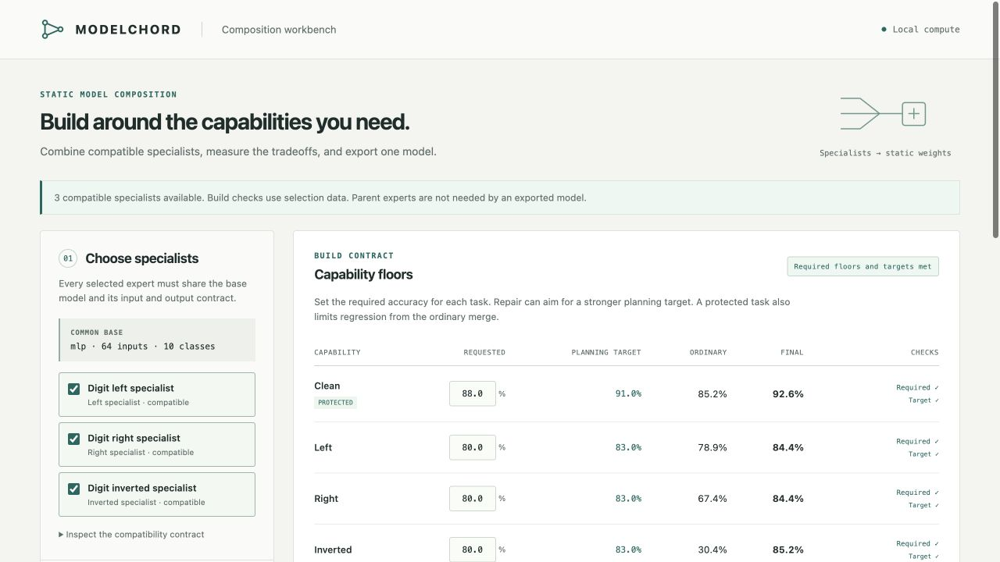

# MODELCHORD

Compose compatible specialists into **one static model**, measure capability shortfalls, and attempt a bounded low-rank repair. The exported model contains its own weights and classifier head; inference does not select or call parent experts.

**v0.2: the selected vision model meets all four required floors on locked confirmation.** It scores 91.11% clean, 82.53% left-shifted, 83.49% right-shifted and 85.01% inverted across 3,823 source images. Ordinary joint training and fixed-factor training also meet the contract and outperform repair on the three transformed tasks. The separate text model fails every floor on distribution-shifted YouTube comments. This is a bounded vision retention result, with no general superiority or universal behavior guarantee.



[20-second captioned demo](docs/media/v02/MODELCHORD-v0.2.0.mp4) · [Capture provenance](docs/media/v02/README.md). The demo uses still captures of completed workbench states and shows development selection scores, separately from confirmation.

## Run locally

Python 3.11–3.13. The recorded environment uses Python 3.12, PyTorch 2.9.1, NumPy 2.2.6 and safetensors 0.6.2. No inference API, key or paid service is needed.

```bash
git clone https://github.com/nazeeh111/ModelChord.git
cd ModelChord
python3.12 -m venv .venv
source .venv/bin/activate
# On Linux, install the CPU wheel first to avoid CUDA dependencies:
# python -m pip install torch==2.9.1 --index-url https://download.pytorch.org/whl/cpu
python -m pip install '.[study,dev]'
python -m pytest -q tests experiments/v02/test_search.py
modelchord serve --project . --port 8765
```

Open [the local workbench](http://127.0.0.1:8765). Select the three digit specialists, RegMean and v2 trained-factor repair; keep floors 88% clean and 80% transformed, rank 8, four stages, 30 steps and a 3-point planning buffer. The workbench uses calibration and selection data only. New local builds are development checks, not new confirmation evidence. See the [v0.2 walkthrough](docs/WALKTHROUGH_V02.md).

Run the fixed static artifacts in separate applications:

```bash
python examples/predict.py experiments/v02/main/vision-seed11-repair/model --input study/demo-vision-inputs.json
python examples/text_app.py experiments/v02/main/text-seed43-repair/model 'Meeting at two.' 'WIN a FREE prize!'
```

Vision has a ten-digit head; text has a `ham`/`spam` head over fixed character features. The text command demonstrates the software integration, not reliable spam detection. These are small classifiers, not arbitrary checkpoint or generative language-model mergers. Wheels contain the library, CLI and web assets; source data and model artifacts are separate. See [GitHub Releases](https://github.com/nazeeh111/ModelChord/releases) for published packages; no PyPI publication is implied.

## Build contract

- Validate common-base identity, architecture, tensor names, precision, label order, preprocessing, tokenizer and declared source-license policy. Same-shaped tensors alone are insufficient; unsupported architectures and tied tensors are rejected.
- Export ordinary arithmetic, averaging, TIES/DARE-style, TSV spectral and activation-informed RegMean merges with layerwise source reads.
- Train small additive factors on permitted calibration data. Six layer/rank interventions compete per stage; distinct selection data determine whether a whole trajectory improves the worst deficit while protecting the original reference.
- Fold accepted corrections into static dense weights; discard rejected trajectories. Keep the ordinary-merge fast path, immutable sources, bounded rank/search and complete failure reports.

Repair is **data-assisted training**. Full-weight joint training is an explicitly separate reference. The [v0.2 API/CLI](docs/API_V02.md), [editable architecture](docs/ARCHITECTURE_V02.md) and [evaluator extension](examples/custom_evaluator.py) document the supported scope. The custom evaluator hook belongs to the retained v1 API; v2 uses its fixed exact-count classifier evaluator.

## Evidence and limits

| Vision11 method | Clean | Left | Right | Inverted | Required floors |
| --- | ---: | ---: | ---: | ---: | ---: |
| RegMean parent | 83.31% | 78.16% | 68.35% | 27.47% | 0/4 |
| v2 repair | 91.11% | 82.53% | 83.49% | 85.01% | 4/4 |
| Joint training | 90.27% | 86.74% | 88.20% | 91.55% | 4/4 |
| Fixed-factor training | 90.58% | 84.12% | 87.78% | 88.39% | 4/4 |

The primary repair passed its stronger planning selection gate before confirmation. Its required confirmation contract passes; its extra planning buffer passes 3/4 tasks. Seed29 repair meets required confirmation floors but stays unaccepted because planning selection failed. Text passes SMS development selection, then fails all four YouTube transfer floors; there is no fresh SMS confirmation.

Repair, joint and fixed-factor references match labeled training accesses, optimizer updates and selection-access ceilings. They do not match exact FLOPs. Fixed-rank and no-protection ablations tie the primary repair exactly. Fresh process build profiles and all 12 exactly reproduced weight identities are retained, with their measurement scope. No mechanism, compute-efficiency or memory-superiority claim follows.

[v0.2 results and costs](docs/RESULTS_V02.md) · [Frozen protocol](experiments/v02/PROTOCOL.md) · [Lock](experiments/v02/confirmation-lock.json) · [Exact outcomes](experiments/v02/confirmation-results.json) · [Independent review](experiments/v02/review/FINAL_REVIEW.md) · [Reproduction](docs/REPRODUCTION_V02.md)

Vision confirmation uses different writers from the old development file, reversing the original UCI benchmark direction. The two expert initializations and task transformations were already used in development. Four views of each source remain correlated. There is no unseen-task/seed, foundation-model, statistical-significance or population-level guarantee. Compatibility and malformed-input tests establish software behavior, not adversarial ML robustness.

The [v0.1 negative-result study](docs/RESULTS.md), original numerical code, models and recipes remain historical evidence. Its sole declared version-metadata exception retains exact archived bytes. The new method and cohort are separately versioned. [Launch draft](docs/LAUNCH_DRAFT.md).

Code and locally trained weights are MIT. UCI-derived data retain CC BY 4.0 attribution. Raw SMS and YouTube messages are excluded from publication. Credit: [Alpaydin/Kaynak optical digits](https://doi.org/10.24432/C50P49), [Almeida/Hidalgo SMS](https://doi.org/10.24432/C5CC84), [Alberto/Lochter YouTube spam](https://doi.org/10.24432/C58885). [Method attribution](docs/ATTRIBUTION.md) and [research notes](research/RESEARCH.md) cover TIES, DARE, TSV, RegMean, mergekit, FusionBench and overlapping work; general novelty is not claimed.
