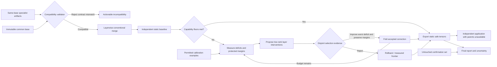

# Architecture

Editable source: [ARCHITECTURE.mmd](ARCHITECTURE.mmd).

The exported application loads one static artifact. Ensembles are comparison references only. Repair changes only bounded low-rank matrix directions and folds accepted edits into the artifact; ordinary full-weight fine-tuning is an explicitly separate baseline. The model and its full classification head are included in all storage and latency reports.
