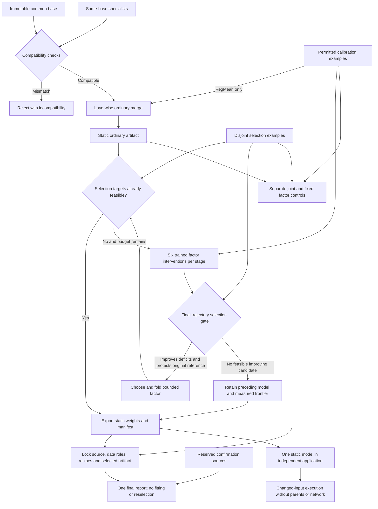

# v0.2 architecture

The Mermaid source below is editable. Build-time parents, calibration and selection are separated from the deployed static model. Ordinary merge and failed-search exports remain valid software artifacts even when they fail the research acceptance contract.

`Artifact.open` checks safe tensors and the declared architecture, input/output contract and identity. A common shape does not establish common training ancestry or preprocessing. The registry is a bounded three-layer classifier; it does not offer streamed backpropagation for giant models.

`modelchord.repair_v2.search` freezes preceding weights and biases, trains a zero-effect-initialized additive factor `B @ A`, and accepts only a final selection checkpoint under the fixed original protection reference. Six layer/rank candidates compete per stage. The lexicographic objective prioritizes worst deficit, then total deficit, then loss. Data-assisted factor training is distinct from the full-weight reference. Accepted factors fold into dense weights; additive rank constraints do not reduce the deployed dense architecture size.

The static application loads the final manifest, all model layers and the full classifier head. It does not load parent specialists, adapters, a teacher, router or ensemble. Text preprocessing is a fixed versioned character feature function and its head lists `ham`/`spam`; vision lists digits 0–9. The integrations are separate compatible families and are never merged together.

The lock fixes primary vision11 and text43 artifact paths before confirmation. Confirmation can reject a selected model, but cannot replace it with a better-looking candidate or retroactively approve failed selection. v0.2 vision11 meets the required measured contract; text shifted transfer fails. [Exact results](RESULTS_V02.md) · [API](API_V02.md) · [Source](../src/modelchord/repair_v2.py).
