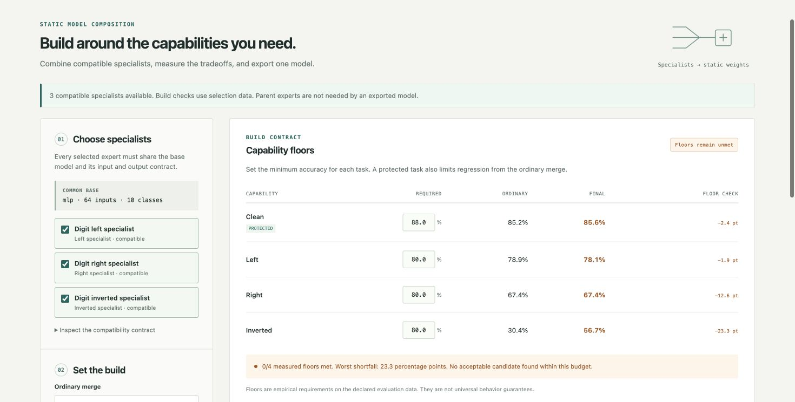
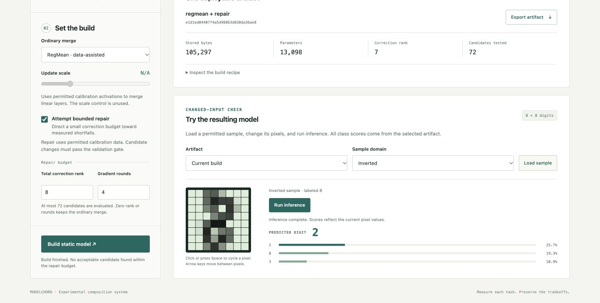

# Short demo

Selected master: [MODELCHORD-demo-v2.mp4](MODELCHORD-demo-v2.mp4),20 seconds,1470×880,H.264,30fps,600 decoded frames, silent.

The film holds captioned captures from completed real local workbench actions for reading. It is edited for time and is not a continuous screen recording. No score, model output or UI state was mocked. The direct screencast attempt produced zero frames; its empty capture ledger is retained. The first video attempt had an FFmpeg percent-text expansion error and is preserved locally, excluded from delivery. v2 uses literal captions and is the selected master.

0–8s: RegMean plus bounded repair on selection data, all floors unmet.8–14s: the static artifact misclassifies an inverted digit as2, confidence36.8%.14–20s: two pixel edits change the leading confidence to25.7%; this demonstrates changed-input responsiveness, not correctness. The underlying label remains8 and the failure is visible.

Editable sources: [render_demo.py](../../scripts/render_demo.py), [source capture/metric manifest](demo-v2-manifest.json), completed PNG captures and the caption files in `demo-v2/`. Captions are narrative labels; actual scores remain visible in the captures. The full video was decoded, duration/frame count checked, and representative encoded frames inspected. No audio or live-motion quality claim is made.

